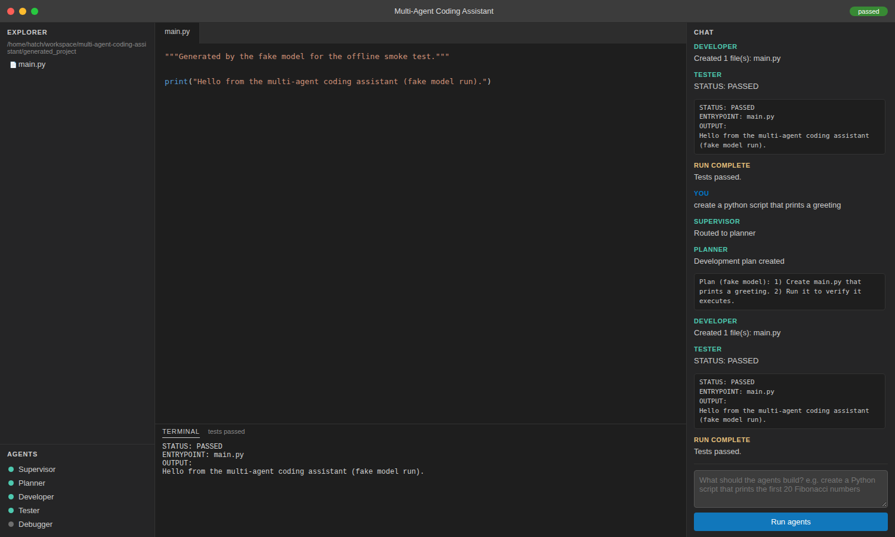

# Multi-Agent Coding Assistant

A LangGraph workflow of specialised agents that takes a plain-English
coding request and produces a small working project:

```
supervisor ──► planner ──► developer ──► tester ──► (pass) END
                                  ▲           │
                                  │           ▼ (fail, max 3 retries)
                                  └────── debugger
```

- **Supervisor** routes the request to the planner or straight to the developer.
- **Planner** writes an architecture/implementation plan.
- **Developer** generates complete files (structured output) into the workspace.
- **Tester** syntax-checks every Python file and runs the entrypoint.
- **Debugger** (ReAct agent with file/command tools) fixes failures; the
  tester re-runs until the project passes or 3 retries are exhausted.

All file access goes through one safe, path-checked workspace API
(`app/tools/workspace_tools.py`) and one allow-listed command runner
(`app/tools/command_tools.py`).

## Setup

```bash
python3 -m venv .venv
.venv/bin/pip install -r requirements.txt
```

By default the agents use a **local Ollama** model (`llama3.2:3b`), so no
API key is needed:

```bash
ollama pull llama3.2:3b
ollama serve
```

## Configuration

Everything is set through environment variables (see `app/config.py`):

| Variable | Default | Meaning |
| --- | --- | --- |
| `MACA_MODEL_PROVIDER` | `ollama` | `ollama`, `gemini`, `openai`, or `fake` |
| `MACA_MODEL` | per provider | Model name, e.g. `llama3.2:3b` |
| `MACA_WORKSPACE` | `<project root>/generated_project` | Where generated code is written |
| `MACA_FAKE_FILES_JSON` | hello-world payload | Files the `fake` provider "generates" |

`gemini` and `openai` read their usual API-key environment variables
(`GOOGLE_API_KEY`, `OPENAI_API_KEY`). The `fake` provider needs no server
and no key; it exists for tests and demos.

## Run the CLI

```bash
.venv/bin/python -m app.main "create a python script that prints the first 20 Fibonacci numbers"
.venv/bin/python -m app.main        # prompts for the request instead
```

Generated code lands in `generated_project/` (or `MACA_WORKSPACE`).

## Run the GUI

```bash
.venv/bin/python -m app.gui
```

Then open **http://127.0.0.1:8765**. The GUI is a single local web app with
a VS Code-like layout:

- **Left sidebar** — file tree of the workspace plus the agent list with
  live status dots.
- **Centre** — read-only code viewer with file tabs and simple syntax
  tinting, and a terminal panel showing the tester's output.
- **Right** — chat panel: type a request, press *Run agents*, and watch
  each agent's progress stream in live (Server-Sent Events).

Backend endpoints: `GET /api/files`, `GET /api/file?path=...`,
`POST /api/run`, `GET /api/events` (SSE), `GET /api/status`.



## Smoke test (no model server needed)

```bash
.venv/bin/python scripts/smoke_test.py
```

Runs the whole graph with the `fake` provider in a throwaway workspace
and asserts that a file is created and the tester reports
`STATUS: PASSED`.
